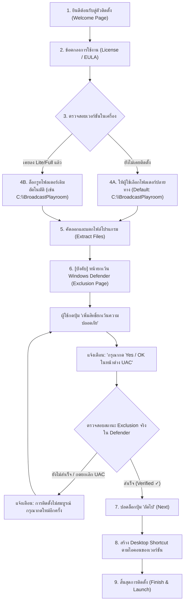

# สถาปัตยกรรมและการออกแบบตัวติดตั้ง (Installer Specification)
## Broadcast Playroom 3 (Lite & FULL Editions)

เอกสารนี้ระบุรายละเอียดโครงสร้าง สถาปัตยกรรม และโฟลว์การทำงานของโปรแกรมติดตั้ง (Installer) สำหรับ Broadcast Playroom 3 ตามข้อกำหนดของผู้พัฒนา

---

## 1. วัตถุประสงค์และหลักการออกแบบ

1. **เลือกปลายทางการติดตั้งได้อย่างอิสระ:** รองรับการเลือกโฟลเดอร์ปลายทาง (ค่าเริ่มต้นแนะนำ: `C:\BroadcastPlayroom\`)
2. **รองรับการติดตั้งร่วมกันระหว่างรุ่น Lite และ FULL (Coexistence Architecture):**
   - ทั้งสองรุ่นสามารถอยู่ร่วมกันในเครื่องเดียวกันได้โดยไม่ทับซ้อนกัน
   - ตรวจจับอัตโนมัติหากมีการติดตั้งรุ่นใดรุ่นหนึ่งอยู่ก่อนแล้ว และบังคับ/แนะนำให้ลงในรูทโฟลเดอร์เดียวกัน
   - ใช้ข้อมูลการใช้งาน (`data`) ร่วมกัน 100% (โปรไฟล์, กฎการอ่านแชท, เสียง, คำแทนที่, OBS Overlay)
3. **ขั้นตอนบังคับขอสิทธิ์ยกเว้น Windows Defender (Mandatory Antivirus Exclusion):**
   - มีหน้า Wizard พิเศษหลังจากแตกไฟล์เสร็จ เพื่อขอสิทธิ์ยกเว้นโฟลเดอร์ของโปรแกรม
   - แสดงกล่องข้อความแจ้งเตือนผู้ใช้อย่างชัดเจนว่าต้องกด "Yes / OK" เมื่อหน้าต่าง UAC ปรากฏ
   - มีระบบตรวจสอบย้อนกลับ (Verification Check) ว่าโฟลเดอร์ได้รับการยกเว้นจริงใน Defender ก่อนจะปลดล็อกให้กด "ถัดไป (Next)" ได้
4. **วาง Desktop Shortcut ตามเวอร์ชันที่ติดตั้ง:**
   - Lite: วางช็อตคัต `Broadcast Playroom Lite` พร้อมไอคอน `bp-lite-icon.ico`
   - FULL: วางช็อตคัต `Broadcast Playroom` พร้อมไอคอน `bp-full-icon.ico`

---

## 2. โครงสร้างโฟลเดอร์ในเครื่องผู้ใช้ (Directory Layout)

```text
C:\BroadcastPlayroom\                        <-- โฟลเดอร์หลัก (Root Directory)
├── data\                                    <-- ข้อมูลการใช้งานที่แชร์ร่วมกัน (Shared User Data)
│   ├── composer_layout.json                 (การจัดวางวิดเจ็ตและเลย์เอาต์หน้าจอ)
│   ├── dictionary.json                      (พจนานุกรมคำแทนที่)
│   ├── bot_accounts.dat                     (การเชื่อมต่อบัญชีสตรีมมิ่ง)
│   ├── dns_settings.json                    (การตั้งค่า DNS)
│   └── log.txt                              (ประวัติข้อความแชท)
│
├── lite\                                    <-- โปรแกรมรุ่น Lite (หากติดตั้ง)
│   ├── BroadcastPlayroom-Lite.exe
│   ├── assets\
│   └── ...
│
└── full\                                    <-- โปรแกรมรุ่น FULL (หากติดตั้ง)
    ├── BroadcastPlayroom-Full.exe
    ├── rvc_models\                          (โฟลเดอร์โมเดล AI Voice)
    ├── assets\
    └── ...
```

---

## 3. การตรวจจับเวอร์ชันเดิมและการลงทับซ้อน (Detection & Coexistence)

ตัวติดตั้งจะบันทึกข้อมูลลง Windows Registry:
- **Registry Key:** `HKCU\Software\BroadcastPlayroom` (หรือ `HKLM` หากเลือกลง All Users)
  - `InstallRoot`: ที่อยู่ของโฟลเดอร์หลัก เช่น `C:\BroadcastPlayroom`
  - `DataDir`: `C:\BroadcastPlayroom\data`
  - `LiteInstalled`: `1` (พร้อม `LitePath`: `C:\BroadcastPlayroom\lite\BroadcastPlayroom-Lite.exe`)
  - `FullInstalled`: `1` (พร้อม `FullPath`: `C:\BroadcastPlayroom\full\BroadcastPlayroom-Full.exe`)

### โฟลว์การทำงานเมื่อมีผู้ใช้ลงรุ่นที่สอง:
1. ผู้ใช้รันตัวติดตั้ง เช่น รัน **FULL Installer** ในขณะที่เคยลง **Lite** ไว้แล้ว
2. ตัวติดตั้งอ่านค่าจาก Registry ตรวจพบว่ามี `InstallRoot` อยู่แล้วที่ `C:\BroadcastPlayroom`
3. ตัวติดตั้งแสดงหน้าต่างแจ้งผู้ใช้:
   > "ตรวจพบว่าเครื่องนี้มีการติดตั้ง Broadcast Playroom (Lite) อยู่แล้วที่ C:\BroadcastPlayroom"  
   > "เพื่อความเข้ากันได้และการแชร์ข้อมูลร่วมกัน ตัวติดตั้งจะติดตั้งเวอร์ชัน FULL ลงใน C:\BroadcastPlayroom\full\"
4. ตัวติดตั้งล็อกโฟลเดอร์รูทให้ตรงกันโดยอัตโนมัติ และตั้งค่าให้ทั้งสองเวอร์ชันเรียกใช้โฟลเดอร์ `data\` เดียวกันผ่านตัวแปรสภาพแวดล้อม `BP3_DATA_DIR`

---

## 4. โฟลว์ขั้นตอนหน้าต่างติดตั้ง (Installer Wizard Steps)



---

## 5. รายละเอียดหน้าบังคับขอสิทธิ์ Windows Defender Exclusion

หน้านี้สร้างขึ้นเป็น Custom Page ในตัวติดตั้ง (เช่น Inno Setup Custom Page หรือ NSIS Page):

### องค์ประกอบบนหน้าจอ:
1. **ข้อความชี้แจง:**
   > **ความสำคัญ:** เนื่องจาก Broadcast Playroom มีระบบแปลภาษาและสังเคราะห์เสียง AI รวมถึงการอัปเดตไฟล์อัตโนมัติ ระบบความปลอดภัย Windows Defender อาจตรวจจับผิดพลาด (False Positive) และลบไฟล์สำคัญขณะอัปเดต  
   > **คำเตือน:** เมื่อกดปุ่มด้านล่าง จะมีหน้าต่างสิทธิ์ผู้ดูแลระบบ (UAC) เด้งขึ้นมา **กรุณากด "ใช่" (Yes) หรือ "OK" ทุกครั้ง** หากปฏิเสธ จะไม่สามารถดำเนินการติดตั้งต่อได้
2. **ปุ่มสั่งการ:**  
   `[ 🛡️ เพิ่มโฟลเดอร์โปรแกรมลงในรายการยกเว้นความปลอดภัย ]`
3. **กล่องแสดงสถานะ (Status Box):**
   - *ก่อนกด:* ⏳ ยังไม่ได้รับการยกเว้น (ปุ่ม "ถัดไป" ถูกปิดการใช้งาน)
   - *ระหว่างดำเนินการ:* 🔄 กำลังขอสิทธิ์และตรวจสอบสถานะความปลอดภัย...
   - *กรณีสำเร็จ:* ✅ ได้รับการยกเว้นความปลอดภัยเรียบร้อยแล้ว (โฟลเดอร์ `C:\BroadcastPlayroom` ได้รับการป้องกัน) -> ปุ่ม "ถัดไป" สว่างพร้อมให้กด

### คำสั่งสคริปต์ที่ใช้ (PowerShell Elevated):
1. **คำสั่งเพิ่ม Exclusion:**
   ```powershell
   Start-Process powershell -Verb RunAs -Wait -ArgumentList "-WindowStyle Hidden -Command Add-MpPreference -ExclusionPath '$INSTALL_ROOT'"
   ```
2. **คำสั่งตรวจสอบว่าได้สิทธิ์จริงหรือไม่ (Verification Check):**
   ```powershell
   $paths = (Get-MpPreference).ExclusionPath
   if ($paths -contains '$INSTALL_ROOT' -or ($paths | Where-Object { $_ -like '$INSTALL_ROOT*' })) {
       exit 0 # ได้รับการยกเว้นจริง
   } else {
       exit 1 # ยังไม่ได้รับการยกเว้น
   }
   ```

---

## 6. ไอคอนและช็อตคัตประจำเวอร์ชัน

- **FULL Version:**
  - ช็อตคัต: `Broadcast Playroom.lnk`
  - ไฟล์ไอคอน: `assets/icons/bp-full-icon.ico` (มีครบทุกความละเอียด 16x16 ถึง 256x256)
- **Lite Version:**
  - ช็อตคัต: `Broadcast Playroom Lite.lnk`
  - ไฟล์ไอคอน: `assets/icons/bp-lite-icon.ico` (มีครบทุกความละเอียด 16x16 ถึง 256x256)

---

## 7. สรุปความพร้อมในการพัฒนา

- ไฟล์ไอคอนและภาพ Splash ได้รับการแปลงและจัดเก็บไว้ในโฟลเดอร์ `assets/` ของโปรเจกต์เรียบร้อย:
  - `assets/icons/bp-full-icon.ico` & `bp-full-icon.png`
  - `assets/icons/bp-lite-icon.ico` & `bp-lite-icon.png`
  - `assets/splash/splash_500.png` (สัดส่วน 500x282)
- ระบบ Splash Screen แบบ 500px พร้อม Border Chase หมุนลื่นไหล 60 FPS ด้วย PySide6 ทำงานและทดสอบเสร็จสมบูรณ์
- แผนงานนี้สามารถนำไปแปลงเป็นสคริปต์ Inno Setup (.iss) ได้ทันทีเมื่อโค้ดโปรแกรมเวอร์ชันแรกเสร็จสมบูรณ์
