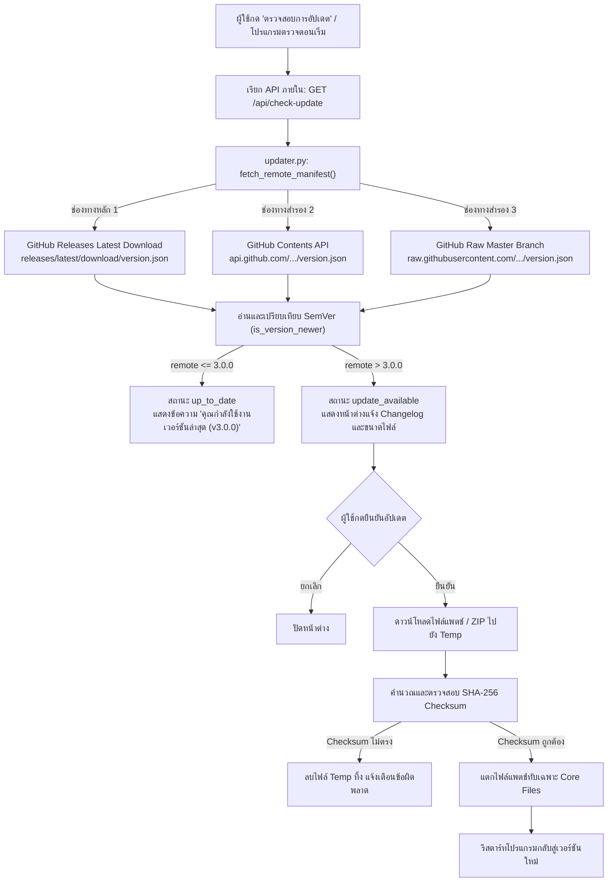

# สถาปัตยกรรมและแผนการออกแบบระบบ In-App Auto Updater (Broadcast Playroom 3)

เอกสารออกแบบระบบอัปเดตอัตโนมัติภายในโปรแกรม (In-App Updater System) สำหรับ **Broadcast Playroom 3 (v3.0.0+)** เพื่อเตรียมพร้อมสำหรับการปล่อยเวอร์ชันปรับปรุงในอนาคต (v3.0.1 เป็นต้นไป) โดยคงความปลอดภัย ความเสถียร และไม่รบกวนข้อมูลผู้ใช้เดิม

---

## 1. หลักการออกแบบและข้อกำหนดสำคัญ (Design Principles)

1. **การแยกสายพัฒนาเด็ดขาดจาก Version 2 (Strict Legacy Isolation)**:
   - โปรแกรมเวอร์ชัน 2 (`broadcast-playroom-ex`) และเวอร์ชัน 3 (`broadcast-playroom-3`) เป็นคนละผลิตภัณฑ์
   - จะ**ไม่มีการอัปเดตข้ามสาย (No cross-version automatic update)** โดยตรงจาก v2 ไป v3
   - ตัวโปรแกรมเวอร์ชันเก่า (v2.x) จะแสดงเพียงการแจ้งเตือนให้ผู้ใช้ดาวน์โหลดเวอร์ชัน 3 ใหม่เป็นไฟล์ติดตั้งแยกต่างหาก
   - การอัปเดตของ v3 จะเริ่มจากจุดตั้งต้น **v3.0.0** เท่านั้น

2. **การปกป้องข้อมูลผู้ใช้ 100% (Zero User Data Overwrite)**:
   - ข้อมูลการตั้งค่า (`composer_layout.json`, `bot_accounts.dat`, `dns_settings.json`, โมเดลเสียง RVC, และประวัติการใช้งาน) ถูกแยกเก็บไว้ใน `%LOCALAPPDATA%\BroadcastPlayroom3\` และโฟลเดอร์ผู้ใช้
   - กระบวนการอัปเดตจะทำการแทนที่เฉพาะไฟล์แกนหลักของโปรแกรม (`_internal/`, `dist/`, executable) โดยจะไม่แตะต้องหรือเขียนทับไฟล์ข้อมูลส่วนตัวของผู้ใช้โดยเด็ดขาด

3. **ความพร้อมในปัจจุบัน (Current Status: Ready & Standby)**:
   - ในเวอร์ชัน **3.0.0** นี้ ระบบ Updater ถูกสร้างและเชื่อมต่อกับ GitHub Repository (`zepiam/broadcast-playroom-3`) เรียบร้อยแล้ว
   - ขณะนี้จะยังไม่มีการดาวน์โหลดหรือติดตั้งอัปเดตใดๆ เนื่องจากเป็นรุ่นเริ่มต้น ระบบจะแจ้งสถานะว่า **"คุณกำลังใช้งานเวอร์ชันล่าสุด (v3.0.0)"**

---

## 2. แผนผังการทำงานของระบบ (System Architecture)



---

## 3. รูปแบบโครงสร้างข้อมูล (Manifest Specification: `version.json`)

ไฟล์ `version.json` บน GitHub Repository ทำหน้าที่เป็น Manifest กลาง:

```json
{
  "product": "broadcast-playroom-3",
  "version": "3.0.0",
  "repo": "zepiam/broadcast-playroom-3",
  "changelog": "- Broadcast Playroom 3.0.0 Initial Release\n- New Discord Dark UI & Canvas Studio\n- Multi-platform live chat & streaming tools\n- Standby Transparency & 0% GPU idle optimization",
  "published_at": "2026-10-28",
  "lite": {
    "type": "standalone",
    "url": "https://github.com/zepiam/broadcast-playroom-3/releases/download/v3.0.0/BroadcastPlayroom3-Lite.zip",
    "size": 0,
    "sha256": ""
  },
  "full": {
    "type": "standalone",
    "url": "https://github.com/zepiam/broadcast-playroom-3/releases/download/v3.0.0/BroadcastPlayroom3-Full.zip",
    "size": 0,
    "sha256": ""
  }
}
```

### การแยก Edition:
- **`lite`**: สำหรับผู้ใช้ที่ต้องการเฉพาะระบบ Live Chat Overlay, เครื่องมือโหวต Ask, สุ่ม Giveaway, นาฬิกา, และเสียงสังเคราะห์มาตรฐาน (ไม่รวม PyTorch / RVC)
- **`full`**: สำหรับผู้ใช้ที่ใช้งานฟังก์ชันครบชุด รวมถึงโมเดลจำลองเสียง AI Voice Changer (RVC)

---

## 4. กลยุทธ์การเชื่อมต่อเครือข่ายและระบบสำรอง (Multi-layer Fetching)

เพื่อป้องกันปัญหาเน็ตเวิร์กและ Rate Limit ของ GitHub:
1. **Static Release URL** (`releases/latest/download/version.json`): เป็น CDN ดาวน์โหลดตรง ไม่ถูกจำกัดโควตา 60 requests/ชม.
2. **GitHub Contents API** (`api.github.com/repos/.../contents/version.json`): ดึงข้อมูลไฟล์แบบ Base64 รวดเร็วและแม่นยำ
3. **Raw GitHub URL** (`raw.githubusercontent.com/.../version.json`): ช่องทางสำรองกรณี API มีปัญหา
4. **SSL Context Fallback**: สลับทดสอบระหว่าง Windows Certificate Store (`win_cert`), Default SSL Context, และโหมด Fallback เพื่อแก้ปัญหาเครื่องผู้ใช้ที่ไม่มี Root CA อัปเดต

---

## 5. อินเทอร์เฟซและการใช้งานบนหน้าจอ (UI & Frontend Integration)

1. **หน้า Settings → เกี่ยวกับโปรแกรม (`sec-about`)**:
   - ป้ายกำกับเวอร์ชัน: `v3.0.0`
   - ป้ายสถานะ: `✅ เวอร์ชันล่าสุด`
   - ปุ่ม **🔄 ตรวจสอบการอัปเดต**:
     - เมื่อกด: ส่งคำขอไปยัง `/api/check-update`
     - แสดงสถานะ `⏳ กำลังตรวจสอบ...`
     - แสดง Toast สรุปผลลัพธ์: `"คุณกำลังใช้งานเวอร์ชันล่าสุด (v3.0.0) แล้วครับ"`
   - ปุ่ม **📦 GitHub Repository**: ลิงก์ตรงไปยัง `https://github.com/zepiam/broadcast-playroom-3`

2. **Backend API Endpoints ใน `launch_dev.py`**:
   - `GET /api/version`: ส่งคืนข้อมูลเวอร์ชันปัจจุบันและ Build type
   - `GET /api/check-update`: รันฟังก์ชัน `check_for_update()` ของ `updater.py` และส่งคืนผลลัพธ์เป็น JSON

---

## 6. ความปลอดภัยและเสถียรภาพ (Security & Integrity)

- **SHA-256 Checksum Validation**: ตรวจสอบค่าแฮชของไฟล์ ZIP/Patch ทุกครั้งก่อนทำการแตกไฟล์
- **Path Traversal Protection**: สแกนรายการไฟล์ใน ZIP เพื่อป้องกัน `..` หรือ Absolute Path ที่อาจเขียนทับโฟลเดอร์อื่นนอกไดเรกทอรีโปรแกรม
- **Atomic Operations**: ดาวน์โหลดลงชื่อไฟล์ชั่วคราว (`.downloading`) ก่อนเปลี่ยนชื่อเมื่อเสร็จสมบูรณ์ หากการดาวน์โหลดถูกยกเลิก ไฟล์ชั่วคราวจะถูกลบทิ้งทันที
